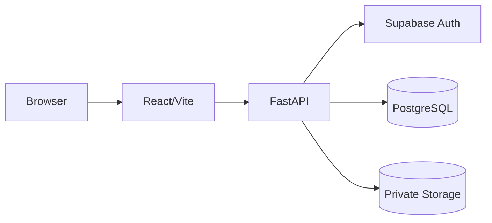

# TrustVault

Live: https://trust-vault-six-ivory.vercel.app/ | Repo: https://github.com/saisankeerth27/TrustVault

TrustVault is a secure document vault for storing, sharing, and auditing documents. Backend enforces all authorization; the frontend never trusts client-side role claims.

## Features

- Upload and manage documents with server-side ownership.
- Share documents with per-user READ or EDIT permissions.
- Version history with optimistic concurrency.
- Soft deletion with retained metadata.
- Tamper-evident audit trail with hash chain.
- Administrator dashboard for users, accounts, and audit events.
- Disable/enable accounts (no permanent deletion).
- Password recovery via Supabase OTP.

## Tech Stack

| Layer | Technology |
|---|---|
| Frontend | React, Vite, Tailwind CSS |
| Backend | FastAPI, Python, SQLAlchemy, Alembic |
| Database | Supabase PostgreSQL |
| Auth | Supabase Auth |
| Storage | Supabase private bucket |
| Hosting | Vercel (frontend), Render (backend) |

## Architecture



## Roles

| Role | Description |
|---|---|
| Document Owner | Manages owned documents, grants/revokes access. |
| Document Viewer | Reads documents explicitly shared with them. |
| Administrator | Monitors users, auth activity, and audit events. |

## Authentication & Authorization

| Area | Description |
|---|---|
| Authentication | Supabase Auth integration. |
| Access Control | Server-side authorization plus DB/storage policies. |
| Disabled Accounts | Cannot access protected resources. |
| Admin Endpoints | Restricted to administrators. |

## Database & Storage

Six tables (users, documents, document_permissions, document_versions, refresh_tokens, audit_events) with constraints and indexes. Private Supabase Storage bucket; objects accessed only via backend.

## Project Structure

```
TrustVault/
├── backend/   # FastAPI app, migrations, tests
├── frontend/  # React app
├── docs/      # Architecture, DB, requirements
└── README.md
```

## Prerequisites

- Node.js 20+
- Python 3.11+
- Supabase project

## Local Setup

Backend:
```powershell
cd backend
python -m venv .venv
.\.venv\Scripts\Activate.ps1
pip install -r requirements-dev.txt
copy .env.example .env
alembic upgrade head
uvicorn app.main:app --reload --port 8000
```

Frontend:
```powershell
cd frontend
npm install
copy .env.example .env
npm run dev
```

## Environment Variables

Backend (required): `DATABASE_URL`, `SUPABASE_URL`, `SUPABASE_ANON_KEY`, `SUPABASE_SERVICE_ROLE_KEY`, `SUPABASE_STORAGE_BUCKET`, `CORS_ALLOWED_ORIGINS`, `PASSWORD_RECOVERY_REDIRECT_URL`. Optional: `AUTH_COOKIE_SECURE`, `AUTH_COOKIE_SAMESITE`, `AUDIT_CHECKPOINT_SIGNING_KEY`, `AUDIT_CHECKPOINT_PATH`.

Frontend (required): `VITE_API_BASE_URL`, `VITE_SUPABASE_URL`, `VITE_SUPABASE_ANON_KEY`.

Never commit real secrets.

## Deployment

- Frontend: Vercel, root `frontend/`, build `npm run build`, output `dist`.
- Backend: Render, root `backend/`, start `uvicorn app.main:app --host 0.0.0.0 --port $PORT`.
- Set env vars in both platforms; run `alembic upgrade head` on production DB.

## Testing

- Backend: `pytest` — 287 tests passed.
- Frontend: `npm run lint`, `npm test`, `npm run build` — all pass.
- Security: IDOR, permission, audit, and auth boundary tests included.

Unverified: live Supabase SMTP delivery and production cookie behavior.

## Known Limitations

- No MFA or account lockout.
- In-memory rate limiting (per process).
- Audit checkpoint is same-host file.
- Supabase Auth SMTP not verified live.

## Security Notes

Backend is authoritative. Deny by default. Private storage. No secrets in source. Fail closed in production.
