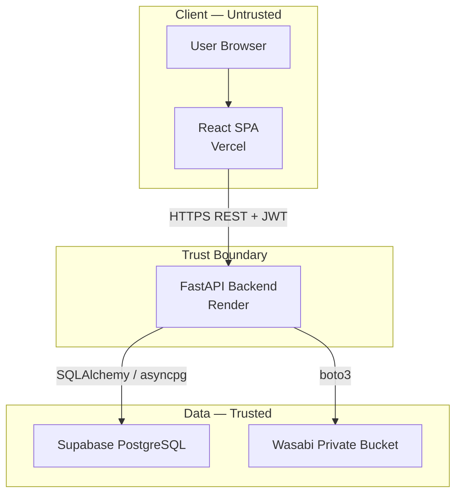

# TrustVault

TrustVault is a secure, multi-tenant document vault that lets organizations store, organize, share, and audit access to sensitive documents. It enforces named-user, per-document READ and EDIT permissions in the backend, records every significant action in a tamper-evident audit trail, and gives administrators a complete view of document activity.

> **Status: Phase 0 — Requirements and Repository Foundation.**
> No application code, database schema, API endpoints, or frontend components exist yet. This repository currently contains planning and documentation only. Claims about functionality, tests, or deployment will be added as each phase is completed and verified.

## Project Objective

Provide a document management system where access control is guaranteed by the backend, not by hiding frontend controls. Document owners decide exactly who can read or edit each document; viewers see only what is shared with them; administrators oversee activity and audit history.

## Technology Stack

| Layer | Technology |
|-------|------------|
| Frontend | React, TypeScript, Vite, Tailwind CSS, shadcn/ui |
| Backend | Python, FastAPI |
| Database | Supabase PostgreSQL |
| ORM / Migrations | SQLAlchemy 2.x, Alembic |
| Object Storage | Wasabi private S3-compatible storage |
| Frontend Hosting | Vercel |
| Backend Hosting | Render |
| Testing | pytest, FastAPI TestClient, integration tests |

## Architecture Overview



The FastAPI backend is the sole authorization enforcement point. It validates every request, checks per-document permissions, proxies file downloads, and writes audit records. The React frontend never talks to the database or storage directly.

See [docs/ARCHITECTURE.md](docs/ARCHITECTURE.md) for full detail.

## Security Principles

- **Backend is authoritative.** Hiding a UI control is not authorization; every request is independently verified server-side.
- **Deny by default.** Access requires explicit ownership, role, or permission grant.
- **Defense in depth.** Application checks, Supabase RLS, private storage, and audit logging layer together.
- **Immutable audit history.** Audit records are append-only and hash-chained; external checkpoints are planned to detect privileged tampering.
- **Secrets never touch source control.** Only `.env.example` templates with placeholders are committed.
- **Fail closed.** External-service failures deny access rather than bypass checks.

See [THREATS.md](THREATS.md) for the full threat model, including residual risks such as the limits of a same-database hash chain and the irreversibility of downloaded copies.

## Planning Documents

- [Requirements](docs/REQUIREMENTS.md) — problem statement, ten mandatory requirements, role matrix, acceptance criteria, traceability.
- [Architecture](docs/ARCHITECTURE.md) — components, flows, security boundaries, environment variables, RLS planning.
- [Implementation Plan](docs/IMPLEMENTATION_PLAN.md) — all 12 phases (0–11) with deliverables, criteria, tests, and commit messages.
- [Threat Model](THREATS.md) — assets, trust boundaries, actors, attack scenarios, mitigations, residual risks.
- [AI Development Log](PROMPTS.md) — dated record of AI-assisted development activity.

## Deployment Destinations

| Component | Provider |
|-----------|----------|
| Frontend | Vercel |
| Backend API | Render |
| Database | Supabase PostgreSQL |
| Object Storage | Wasabi (private) |

No deployment has been verified yet. Deployments begin in Phase 1 and are hardened in Phase 10.

## Setup Direction

The project is not yet runnable. Planned layout:

```
TrustVault/
├── frontend/          # React + TypeScript + Vite (Phase 1)
├── backend/           # FastAPI application (Phase 1)
├── docs/              # Requirements, architecture, implementation plan
├── THREATS.md
├── PROMPTS.md
└── README.md
```

Planned setup (Phases 1+):

1. Copy `.env.example` to `.env` in `frontend/` and `backend/`, then fill in real values locally. Never commit `.env`.
2. Install frontend dependencies and run the dev server.
3. Create a Python virtual environment, install backend dependencies, and run `uvicorn`.
4. Apply database migrations with Alembic once the schema exists (Phase 2).

Required environment variable names are documented in [docs/ARCHITECTURE.md](docs/ARCHITECTURE.md#13-required-environment-variables) using placeholders only.

## Current Project Status

| Phase | Status |
|-------|--------|
| 0 — Requirements and Repository Foundation | In progress |
| 1 — Project Scaffold and Early Deployment | Not started |
| 2 — Database Schema and Migrations | Not started |
| 3 — Authentication and Roles | Not started |
| 4 — Private Storage and Validated Uploads | Not started |
| 5 — Document Management and Search | Not started |
| 6 — Document Permissions and Revocation | Not started |
| 7 — Audit Trail and Administrator Activity | Not started |
| 8 — Security Tests and Threat-Model Verification | Not started |
| 9 — Complete Frontend | Not started |
| 10 — Deployment Hardening and End-to-End Verification | Not started |
| 11 — Final Submission and Demo | Not started |

## Security Note for Contributors

Never commit credentials, database passwords, service-role keys, access tokens, or private keys. If a secret is exposed, treat it as compromised and rotate it immediately. Report suspected exposure to the repository owner.
