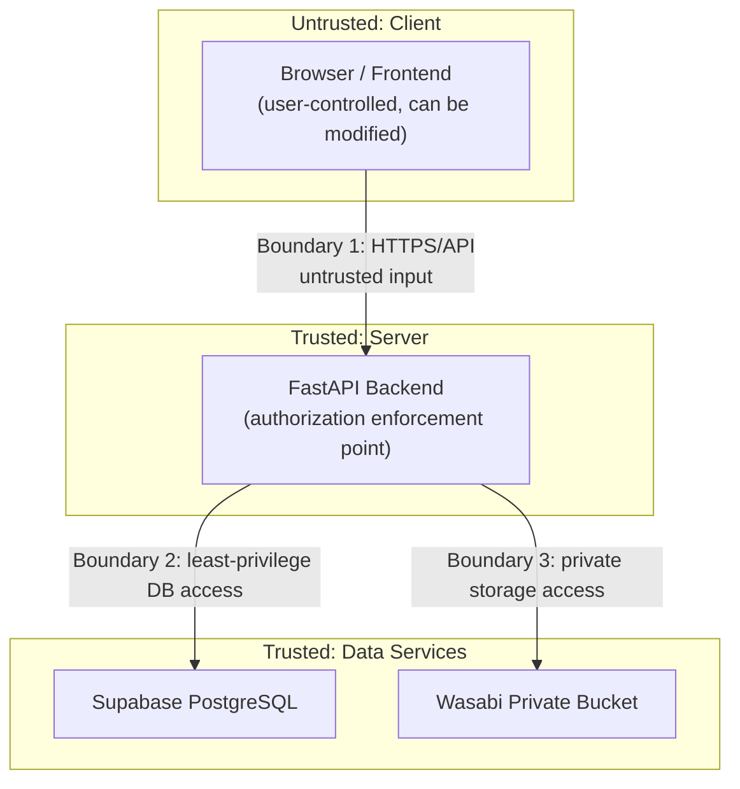

# TrustVault — Threat Model

This threat model documents the assets TrustVault protects, the trust boundaries it enforces, the actors who may attempt to compromise it, the attack scenarios it must resist, and the mitigations and residual risks associated with each.

---

## 1. Assets

| Asset | Description | Sensitivity |
|-------|-------------|-------------|
| Document contents | Files stored in Wasabi private storage | Critical |
| Document metadata | Names, owners, categories, timestamps | High |
| Permission grants | Which users may read or edit which documents | High |
| User credentials | Password hashes, refresh tokens | Critical |
| JWT signing secret | Secret used to sign and verify access tokens | Critical |
| Audit records | Tamper-evident history of all actions | High |
| Service credentials | Supabase service role key, Wasabi keys, database URL | Critical |
| User identities and roles | Account and role assignments | Medium–High |

---

## 2. Trust Boundaries

**Boundary 1 — Client to API.** All client input is untrusted. The frontend can be modified, bypassed, or replaced by an attacker with browser devtools or a direct HTTP client. Every request must be independently authorized by the backend.

**Boundary 2 — API to Database.** The backend connects with elevated credentials. Any bug in authorization or query construction can expose data. RLS provides a secondary barrier.

**Boundary 3 — API to Storage.** Storage is private. Clients never receive direct storage URLs. All file access is mediated and authorized by the backend.

**Boundary 4 — Operators/Administrators.** A privileged database or infrastructure administrator has capabilities that the application cannot fully constrain. This boundary is addressed through audit checkpointing and separation of duties where feasible.

---

## 3. Threat Actors

| Actor | Capability | Motivation |
|-------|------------|------------|
| Unauthenticated external attacker | Can send arbitrary HTTP requests; no credentials | Data theft, disruption |
| Authenticated viewer (low privilege) | Valid account with limited grants | Access documents beyond their grants |
| Malicious document owner | Can upload and grant permissions on own documents | Excessive sharing, concealment |
| Compromised account holder | Valid credentials stolen or coerced | Impersonation, data exfiltration |
| Insider with database access | Direct database or infrastructure access | Alter or hide audit trails, exfiltrate data |
| Automated bot / scanner | High-volume requests | Brute force, denial of service |

---

## 4. Attack Scenarios, Mitigations, and Verification

### 4.1 Insecure Direct Object Reference (IDOR)

**Scenario:** A user guesses or enumerates document IDs and requests documents they were never granted access to.

**Mitigation:** Phase 6 document endpoints resolve visibility from ownership and active grants on every request. Regular users see owned plus actively shared documents; administrators may read all active metadata. Edit, download, delete, and permission management are separately checked. IDs are UUIDs (hard to enumerate but not relied upon for security), and inaccessible/missing IDs return the same generic 404.

**Verification:** Phase 5 tests established generic 404 IDOR denial. Phase 6 adds grant-based tests for unrelated documents, cross-document permission IDs, anonymous callers, and revoked access.

**Residual Risk:** Low. UUIDs reduce discoverability but authorization does not depend on secrecy of IDs.

---

### 4.2 Unauthorized Downloads

**Scenario:** A user attempts to download a document via a direct link, guessed storage key, or API manipulation.

**Mitigation:** The bucket is intended to be private. Uploads never return a direct or presigned URL or the storage key. The download proxy authorizes OWNER, EDIT, or READ capability from current database state before reading from storage and streams the body without exposing the key or a direct URL. Storage-not-found and configuration/operation failures return generic responses. Successful/denied downloads are logged operationally but not yet audited.

**Verification:** Phase 5–6 tests assert owner/READ/EDIT download permissions, generic 404 denial for unrelated users and ungranted administrators, immediate post-revocation denial, safe attachment/no-store headers, header-injection resistance, and no storage-key leakage.

**Residual Risk:** Low after the bucket policy is verified. The live Wasabi private policy and download behavior have **not** been verified. Files already downloaded before a revocation cannot be recalled — see 4.4.

---

### 4.3 Privilege Escalation

**Scenario:** A viewer attempts to act as an owner or administrator by tampering with JWT claims, role fields in requests, or permission endpoints.

**Mitigation:** Roles are stored server-side and derived from the authenticated identity, never trusted from client-supplied body or header fields. JWT signature validation prevents claim tampering. Permission-management endpoints require document ownership; administrator status does not grant sharing or content access.

**Verification:** Tests attempt role manipulation via JWT tampering and request body injection and assert denial. Audit records for denials remain Phase 7.

**Residual Risk:** Low, provided the signing secret remains confidential.

---

### 4.4 Access After Revocation

**Scenario:** A user whose permission was revoked attempts to continue accessing the document (e.g., relying on cached tokens or client state).

**Mitigation:** Permissions are checked on every request against current database state. No permission caching serves stale data. Revocation is immediate. The issued access token authorizes identity, not document access.

**Verification:** Phase 6 tests grant access, confirm success, revoke, then immediately assert 404 for detail/download/edit because the user no longer has any access, and confirm shared listings exclude the revoked document.

**Residual Risk:** **Downloaded copies cannot be recalled.** Once a user has downloaded a file, revocation cannot remove it from their device. This is inherent to all document-sharing systems and must be communicated to users.

---

### 4.5 Malicious Uploads

**Scenario:** A user uploads malware, an executable disguised as an allowed type, a polyglot file, or a zip bomb.

**Mitigation (implemented for upload/download):** Enforce a 10 MiB default size limit (including early `Content-Length` rejection), an extension and MIME allow-list, magic-byte/signature verification, filename validation, empty-file rejection, DOCX OOXML member limits, and NUL-free UTF-8 TXT validation. Executable types are not allowed. The backend computes the checksum, generates the storage key, and stores files privately. Uploaded content is never executed or rendered server-side. Downloads are forced as attachments with `nosniff` and no-store headers. Malware scanning remains future work.

**Verification:** Unit tests cover each validation rule; integration tests cover mismatched extensions/content, unsafe names, empty files, oversized requests, Viewer denial, storage failure, and metadata-failure cleanup.

**Residual Risk:** Medium without antivirus scanning. Signature checks are not a malware scanner and can be bypassed by a valid but malicious document. A zero-day in a viewed document format is outside the application's control. Recommend adding scanning in a later phase.

---

### 4.6 Path Manipulation

**Scenario:** A crafted filename such as `../../etc/passwd` or a null-byte injection manipulates storage paths or local filesystem writes.

**Mitigation (implemented for upload):** The application never uses client filenames as filesystem or storage paths. Phase 4 creates `documents/{owner_uuid}/{random_uuid}.{ext}` from server-side values. Path separators, NUL/control characters, and names over 255 characters are rejected; the original name is metadata only.

**Verification:** Tests assert rejection of traversal/NUL/control-character filenames and verify generated storage keys do not contain the user filename.

**Residual Risk:** Low.

---

### 4.7 Unauthorized Permission Changes

**Scenario:** A viewer or unrelated user grants themselves or others access to a document they do not own.

**Mitigation:** Permission endpoints require the caller to be the document owner. The recipient must be an active registered account, owner self-grants are rejected, client-supplied grantor/recipient IDs are rejected, and permission IDs must belong to the requested document. Audit writes are deferred to Phase 7.

**Verification:** Phase 6 tests attempt grants/list/update/revoke as unrelated owners, administrators, READ/EDIT recipients, and anonymous callers, and assert 403/404 denial without mutation. Audit records remain Phase 7.

**Residual Risk:** Low.

---

### 4.8 Audit Tampering

**Scenario:** An attacker or privileged insider modifies or deletes audit records to hide unauthorized activity.

**Mitigation:** Audit records are intended to be append-only at the application level (no UPDATE/DELETE endpoints). The Phase 7 writer will include a hash of the previous record, forming a tamper-evident chain, and verification utilities will detect chain breaks. RLS is not enabled, so the database does not currently restrict modification.

**Limitation and Residual Risk:** **A hash chain stored only in the same database does not fully protect against a privileged attacker.** An attacker with direct database access can modify a record and recompute all subsequent hashes, producing a locally valid chain. To mitigate, TrustVault plans independently controlled signed checkpoints: periodically hash the chain head and publish/store the digest in an append-only external system or a separately administered store. Comparison against these checkpoints makes tampering detectable even by database administrators. Until external checkpoints are implemented, detection depends on out-of-band chain snapshots.

**Verification:** Tests that API modification is impossible; chain verification tests that detect deliberate tampering; proposed checkpoint tests in a later phase.

---

### 4.9 Metadata Leakage

**Scenario:** Error messages, search results, headers, or logs reveal document existence, ownership, or contents to unauthorized users.

**Mitigation:** Upload and document responses expose only safe metadata and never the storage key, URL, or credentials. Role denials, missing/inaccessible IDs, and storage failures return generic messages; internal storage errors are logged without credentials. Phase 5 download authorization occurs before any content headers are returned, and attachment filenames are encoded with control characters neutralized.

**Verification:** Tests assert generic storage/persistence errors, secret-safe logs, metadata-only response fields, owner-only download denial, safe attachment encoding, and no storage-key leakage.

**Residual Risk:** Low–Medium. Timing side channels and name leakage in shared contexts require ongoing review.

---

### 4.10 Exposed Credentials

**Scenario:** Secrets (database URL, service role key, Wasabi keys, JWT secret) are committed, logged, or exposed in client bundles.

**Mitigation:** Secrets live only in environment variables. `.env` files are gitignored; `.env.example` contains placeholders only. Wasabi credentials are server-side settings returned by the backend configuration, never `VITE_*` values. Storage errors and logs omit credentials and keys. Secret scanning is required before each commit. Credentials are rotated if exposure is suspected.

**Verification:** Phase 4 tests assert secret-safe storage logging; the final commit requires a staged-file secret scan and build-output review.

**Residual Risk:** Medium if operational discipline lapses. Any leaked credential must be treated as compromised and rotated immediately.

---

### 4.11 Weak RLS Policies

**Scenario:** Misconfigured Row-Level Security policies allow cross-tenant reads or writes, or the service role is used from the client.

**Mitigation:** RLS is defense-in-depth, not the primary control. The service role key is used only server-side. Policies are reviewed and tested. Application-level authorization is authoritative.

**Verification:** Policy tests for each table; tests confirming the client never receives the service role key.

**Residual Risk:** Low–Medium. RLS mistakes are caught by application-level checks, but policy drift must be reviewed.

---

### 4.12 Session and Token Theft

**Scenario:** An attacker steals an access or refresh token via XSS, insecure storage, or network interception.

**Mitigation:** HTTPS in production. Phase 3 keeps the access token in memory and the refresh token in an HttpOnly, path-scoped cookie with configurable Secure/SameSite flags. Access tokens are short-lived; refresh tokens rotate and are stored only as SHA-256 hashes. Reuse detection revokes the session family, and logout/disablement invalidates access through per-request session checks. A strong CSP remains planned for Phase 10.

**Verification:** Token expiry tests; refresh rotation tests; reuse-detection tests; CSP header checks.

**Residual Risk:** Medium. Stolen access tokens remain valid until expiry; short TTLs limit the window.

---

### 4.13 Brute-Force and Credential Stuffing

**Scenario:** Automated attempts to guess passwords or replay leaked credentials.

**Mitigation:** Phase 3 applies an in-memory sliding-window limit to login and registration (default 10 attempts per 60 seconds), uses bcrypt with a strong work factor, and returns generic errors to reduce user enumeration. Account lockout, shared multi-instance limiting, and MFA remain future work.

**Verification:** Rate-limit tests; generic error message tests; timing considerations reviewed.

**Residual Risk:** Medium without MFA. Credential stuffing against reused passwords remains possible.

---

### 4.14 Denial of Service

**Scenario:** High-volume requests, large uploads, or expensive queries exhaust backend, database, or storage resources.

**Mitigation:** Authentication rate limiting, a 10 MiB default upload limit (configurable up to 100 MiB), early `Content-Length` rejection, DOCX expansion limits, future query pagination/request limits, timeouts on external calls, and provider-level protections (Render/Vercel/Supabase). Health checks and monitoring.

**Verification:** Upload-size and DOCX-expansion tests pass; load tests and pagination caps remain later work.

**Residual Risk:** Medium. Managed providers absorb much of this, but application-level floods require continued tuning.

---

## 5. Security Principles

1. **Backend is authoritative.** Frontend visibility is never authorization.
2. **Deny by default.** Access is granted only by explicit ownership, role, or permission grant.
3. **Least privilege.** Credentials and roles carry only the access they require.
4. **Defense in depth.** Application checks plus RLS plus private storage plus audit.
5. **Immutable history.** Audit records are append-only and hash-chained.
6. **Secrets never touch source control.**
7. **Fail closed.** External-service failures deny access rather than bypass checks.

---

## 6. Residual Risks Summary

| Risk | Severity | Notes / Future Work |
|------|----------|---------------------|
| Downloaded copies cannot be recalled after revocation | Inherent | Communicate to users; consider watermarking |
| Privileged DB attacker can rewrite local hash chain | High | Implement external signed checkpoints |
| Malware in uploaded files | Medium | Add antivirus scanning; validation is not scanning |
| Live Wasabi bucket policy/connectivity unverified | Medium | Verify private policy, least-privilege keys, and upload/delete behavior before deployment |
| Upload object and metadata are not transactional | Low–Medium | Best-effort cleanup only; monitor orphans and add reconciliation |
| Soft-deleted metadata can outlive a failed object cleanup | Low–Medium | Cleanup is best-effort after commit; log and reconcile private orphans |
| Document and permission actions are not audited yet | Medium | Phase 7 writes view/download/edit/delete/permission/denied events |
| Stolen access token valid until expiry | Medium | Short TTL; consider token binding |
| Credential stuffing without MFA | Medium | Evaluate MFA |
| Application-level DoS | Medium | Rate limits, provider protections |

---

## 7. Phase 1 Implementation Notes (Verified)

These notes record what is actually implemented in the Phase 1 scaffold. Planned mitigations elsewhere in this document are not active yet.

- **CORS is configuration-driven.** Origins come from `CORS_ALLOWED_ORIGINS`; wildcards are rejected outside development. Automated tests confirm allowed origins receive CORS headers and untrusted origins do not.
- **The health endpoint exposes no configuration.** `GET /health` returns only `status`, `service`, and `version`. It performs a process-level check and does **not** query PostgreSQL or Wasabi. A test asserts that configuration markers are absent.
- **No authorization exists yet.** Authentication, document access, permissions, and audit persistence are not implemented in Phase 1. The threat mitigations that depend on them are planned, not verified.
- **No production security headers yet.** CSP and HSTS are planned for Phase 10 deployment hardening.

---

## 8. Phase 2 Implementation Notes (Verified)

These notes record what the Phase 2 schema does and does not enforce. Planned mitigations elsewhere remain planned unless listed here.

- **Schema constraints are enforced by PostgreSQL.** Unique, check, and partial-unique indexes are applied by the initial Alembic migration and exercised by tests against a real PostgreSQL instance. See `docs/DATABASE.md`.
- **RLS is not enabled.** The backend connects with a single privileged database role that bypasses Row-Level Security. Phase 3 keeps that model while adding application-level authentication and roles. Authorization is therefore **not** provided by the database, and TrustVault must not be described as RLS-complete.
- **Audit history is retained, not yet written.** `audit_events.actor_id` and `audit_events.document_id` use `ON DELETE SET NULL` so deleting a user or document preserves the event with its action and details. No application code writes audit rows yet (Phase 7), and the `event_hash`/`previous_hash` columns are not populated by any trust boundary yet.
- **Audit immutability is not database-enforced.** A database immutability trigger or revoke-based policy would conflict with the `ON DELETE SET NULL` foreign keys and with the application-level design, so it is deferred to Phase 7 alongside the write path and hash-chain verification.
- **Deletion semantics are deliberate.** `documents.owner_id` uses `ON DELETE RESTRICT`, `document_permissions` cascades from documents/users, and `documents.deleted_at` provides soft deletion. These choices are documented in `docs/DATABASE.md`.
- **Only sanitized placeholders are committed.** `backend/.env.example` contains placeholders; `DATABASE_URL` is supplied through the environment. No production connection string or credential is stored in the repository, and the Phase 2 migration was never run against production.

**Residual risk after Phase 2:** Medium, unchanged for authorization. The database is prepared but no access control path exists until Phase 3; database-level defense in depth is deferred.

---

## 9. Phase 3 Implementation Notes (Verified)

These notes record the authentication controls that are actually implemented. Planned document and audit controls remain planned.

- **Password storage:** bcrypt hashes only; cost is configurable (default 12). Passwords are limited to 12–72 UTF-8 bytes. Unknown accounts perform a dummy bcrypt verification to reduce timing-based enumeration.
- **Access tokens:** HS256 JWTs with issuer/audience, type, expiry, session, and role claims. The role claim is informational; authorization reads the current database role.
- **Refresh sessions:** 256-bit opaque tokens stored as SHA-256 hashes, grouped into families. Rotation marks the old token revoked and links the replacement; reuse revokes the family.
- **Immediate invalidation:** protected requests verify the user's active status and an active refresh family on every call. Logout, disablement, and reuse detection invalidate existing access tokens without waiting for JWT expiry.
- **Cookie and CSRF controls:** refresh cookie is HttpOnly with path `/api/v1/auth`; production requires Secure. Auth POSTs enforce an exact Origin allow-list. A per-session CSRF token is not implemented, and cross-site cookies remain dependent on browser policy.
- **Rate limiting:** in-memory and per process. It is not a shared limiter and can be bypassed by distributing requests across instances; production hardening must address this.
- **Account provisioning:** public registration always creates a Viewer. Elevated roles require the server-side CLI; clients cannot request a role.
- **Secret-free logging:** tests assert that auth logs do not include passwords, access tokens, refresh tokens, or email addresses. Alembic logging is configured with `disable_existing_loggers=False` so application loggers remain active.
- **Residual risks after Phase 3:** no MFA, no account lockout, no idle timeout, no per-session CSRF token, no shared rate limiter, and no deployed verification of cross-site cookies. Stolen access tokens remain valid only while the session stays active and the token stays unexpired (15 minutes by default).

---

## 10. Phase 4 Implementation Notes (Verified with Mocked Storage)

These notes record the upload/storage controls that are actually implemented. Downloads, permissions, and audit writes remain planned.

- **Authorization:** `POST /api/v1/documents/upload` requires an active `ADMINISTRATOR` or `DOCUMENT_OWNER`; Viewers receive 403 and anonymous callers 401. Ownership is taken from the authenticated user, never client input.
- **Input validation:** Extension and declared-MIME allow-list, magic-byte/signature checks, empty-file rejection, 10 MiB default limit with early `Content-Length` rejection, filename length/control-character/path-separator rejection, DOCX member count/uncompressed-size checks, and NUL-free UTF-8 TXT validation.
- **Key and checksum integrity:** Storage keys are generated from server-side UUIDs; the backend computes SHA-256 from received bytes and ignores client checksums. The user filename never becomes a path.
- **Private access:** No direct/presigned URL or storage key is returned to the client. The frontend never receives Wasabi credentials.
- **Failure behavior:** Missing/misconfigured storage or Wasabi failure returns generic 503 with no metadata row. A metadata commit failure after upload returns generic 500 and attempts best-effort object deletion.
- **Secret handling:** Storage errors are logged without credentials or internal details; configuration is server-side only. Tests assert secret-safe logging and responses.
- **Frontend migration:** TypeScript/TSX was removed in favor of JavaScript/JSX; lint and build pass.
- **Verification:** 107 backend tests passed at Phase 4 completion. Storage tests use a fake adapter; **no test contacted Wasabi**. Live bucket privacy, credentials, permissions, and connectivity remain unverified.
- **Not implemented at Phase 4 completion:** Download/listing, permission grants, audit writes, malware scanning, RLS, and deployment.

---

## 11. Phase 5 Implementation Notes (Verified with Mocked Storage)

These notes record the document-management controls implemented at Phase 5 completion. Permission grants and audit writes were still planned at that point.

- **Metadata scoping at Phase 5 completion:** Owners saw only their active documents; administrators could read active metadata across the library; viewers saw none. Update, download, and delete required ownership. Inaccessible and missing IDs both return generic 404.
- **Query safety:** Name search is parameterized and escapes `\`, `%`, and `_` so user input cannot become a wildcard. Category/owner/date filters are parameterized; sort columns are an allow-list; page size is bounded.
- **Metadata integrity:** Only `name`, `category`, and `description` can be changed. Storage key, owner, MIME type, size, checksum, and timestamps are not client-updatable; extra fields are rejected.
- **Download:** The backend authorizes ownership before reading from private storage and streams the object. Responses set an attachment filename, `Content-Length`, `Cache-Control: private, no-store`, and `X-Content-Type-Options: nosniff`. Filenames are RFC 5987-encoded with sanitized ASCII fallbacks.
- **Deletion:** Soft deletion sets `deleted_at` and excludes the row from all normal reads. Wasabi cleanup happens after the database commit and is best-effort; failure is logged, and metadata is retained.
- **Failure handling:** Missing storage objects return generic 404; storage configuration/operation failures return generic 503. No storage key, URL, or credential is exposed to the client or logs.
- **Verification at Phase 5 completion:** 127 backend tests passed, including management authorization, filter/query safety, pagination, IDOR behavior, protected-field rejection, download headers/failures, soft delete, and cleanup failure. Frontend lint/build passed.
- **Not implemented at Phase 5 completion:** Explicit READ/EDIT grants, immediate revocation, audit events, live Wasabi download/delete verification, malware scanning, RLS, and deployment.

---

## 12. Phase 6 Implementation Notes (Verified with Mocked Storage)

These notes record the authorization controls actually implemented for named-user sharing. Audit writes and live storage verification remain outstanding.

- **Central enforcement:** `app/services/document_access.py` resolves access from current ownership and active grants on every request and maps it to explicit metadata/read/edit/delete/manage capabilities. There is no authorization cache.
- **Grant management:** Only the document owner can list, grant, update, or revoke access. Recipients must be active registered users identified by normalized email. Same-level grants are idempotent; conflicting levels return 409; cross-document permission IDs return 404.
- **History:** Updates revoke the previous row and insert a replacement. Revocation is idempotent and retains the row. The partial unique index prevents multiple active grants.
- **Administrator boundary:** Administrators can read metadata for all active documents but receive no content, edit, delete, or permission-management capability unless they own the document or receive an explicit grant.
- **Shared listing:** /api/v1/documents/shared-with-me includes only active grants on active, non-deleted documents. The regular document list includes owned plus actively shared documents.
- **Revocation semantics:** After revocation, content and edit requests return generic 404 because the user no longer has document visibility. Downloaded copies remain outside the system's control.
- **Verification:** 146 backend tests pass, including 19 Phase 6 tests for owner-only management, READ/EDIT/administrator boundaries, forged fields, idempotency/conflicts, history retention, immediate revocation, shared-list exclusions, and cross-document IDOR. Frontend lint/build pass.
- **Not implemented/verified:** Audit event writes/views, live Wasabi behavior, malware scanning, RLS, and deployment.
