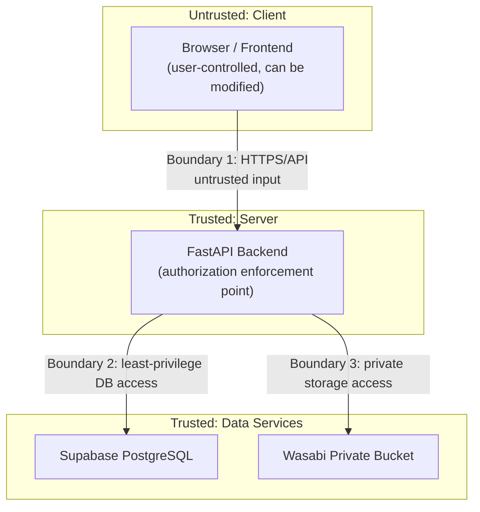

# TrustVault — Threat Model

This threat model documents the assets TrustVault protects, the trust boundaries it enforces, the actors who may attempt to compromise it, the attack scenarios it must resist, and the mitigations and residual risks associated with each.

---

## 1. Assets

| Asset | Description | Sensitivity |
|-------|-------------|-------------|
| Document contents | Files stored in Wasabi private storage | Critical |
| Document metadata | Names, owners, categories, timestamps | High |
| Permission grants | Which users may read or edit which documents | High |
| User credentials | Password hashes, refresh tokens | Critical |
| JWT signing secret | Secret used to sign and verify access tokens | Critical |
| Audit records | Tamper-evident history of all actions | High |
| Service credentials | Supabase service role key, Wasabi keys, database URL | Critical |
| User identities and roles | Account and role assignments | Medium–High |

---

## 2. Trust Boundaries

**Boundary 1 — Client to API.** All client input is untrusted. The frontend can be modified, bypassed, or replaced by an attacker with browser devtools or a direct HTTP client. Every request must be independently authorized by the backend.

**Boundary 2 — API to Database.** The backend connects with elevated credentials. Any bug in authorization or query construction can expose data. RLS provides a secondary barrier.

**Boundary 3 — API to Storage.** Storage is private. Clients never receive direct storage URLs. All file access is mediated and authorized by the backend.

**Boundary 4 — Operators/Administrators.** A privileged database or infrastructure administrator has capabilities that the application cannot fully constrain. This boundary is addressed through audit checkpointing and separation of duties where feasible.

---

## 3. Threat Actors

| Actor | Capability | Motivation |
|-------|------------|------------|
| Unauthenticated external attacker | Can send arbitrary HTTP requests; no credentials | Data theft, disruption |
| Authenticated viewer (low privilege) | Valid account with limited grants | Access documents beyond their grants |
| Malicious document owner | Can upload and grant permissions on own documents | Excessive sharing, concealment |
| Compromised account holder | Valid credentials stolen or coerced | Impersonation, data exfiltration |
| Insider with database access | Direct database or infrastructure access | Alter or hide audit trails, exfiltrate data |
| Automated bot / scanner | High-volume requests | Brute force, denial of service |

---

## 4. Attack Scenarios, Mitigations, and Verification

### 4.1 Insecure Direct Object Reference (IDOR)

**Scenario:** A user guesses or enumerates document IDs and requests documents they were never granted access to.

**Mitigation:** Every document endpoint performs an object-level authorization check against `document_permissions`, ownership, and role. IDs are UUIDs (hard to enumerate but not relied upon for security). Unauthorized access returns 403 (or 404 without leaking existence).

**Verification:** Dedicated IDOR tests in Phase 8 request documents with valid IDs belonging to other users and assert denial for GET, download, PUT, and DELETE.

**Residual Risk:** Low. UUIDs reduce discoverability but authorization does not depend on secrecy of IDs.

---

### 4.2 Unauthorized Downloads

**Scenario:** A user attempts to download a document via a direct link, guessed storage key, or API manipulation.

**Mitigation:** Storage bucket is private. Downloads are proxied through the backend after authorization and audit logging. No direct presigned or public URLs are returned to clients. Storage keys are system-generated and never exposed.

**Verification:** Tests assert that unauthorized download requests receive 403, that no API response contains storage URLs, and that direct bucket access is denied.

**Residual Risk:** Low. However, files already downloaded before a revocation cannot be recalled — see 4.4.

---

### 4.3 Privilege Escalation

**Scenario:** A viewer attempts to act as an owner or administrator by tampering with JWT claims, role fields in requests, or permission endpoints.

**Mitigation:** Roles are stored server-side and derived from the authenticated identity, never trusted from client-supplied body or header fields. JWT signature validation prevents claim tampering. Permission-management endpoints check the caller is owner or admin.

**Verification:** Tests attempt role manipulation via JWT tampering and request body injection and assert denial with audit records.

**Residual Risk:** Low, provided the signing secret remains confidential.

---

### 4.4 Access After Revocation

**Scenario:** A user whose permission was revoked attempts to continue accessing the document (e.g., relying on cached tokens or client state).

**Mitigation:** Permissions are checked on every request against current database state. No permission caching serves stale data. Revocation is immediate. The issued access token authorizes identity, not document access.

**Verification:** Tests grant access, confirm success, revoke, then immediately re-request and assert 403.

**Residual Risk:** **Downloaded copies cannot be recalled.** Once a user has downloaded a file, revocation cannot remove it from their device. This is inherent to all document-sharing systems and must be communicated to users.

---

### 4.5 Malicious Uploads

**Scenario:** A user uploads malware, an executable disguised as an allowed type, a polyglot file, or a zip bomb.

**Mitigation:** Enforce size limits, MIME allow-list, and magic-byte verification. Disallow executable types. Store files privately and serve with safe `Content-Disposition` (attachment) and a restrictive `Content-Type`. Never execute or render uploaded content server-side. Consider malware scanning as a future enhancement.

**Verification:** Unit tests for validation rules; integration tests uploading mismatched extensions and oversized files; tests asserting rejection of executable MIME types.

**Residual Risk:** Medium without antivirus scanning. A zero-day in a viewed document format is outside the application's control. Recommend adding scanning in a later phase.

---

### 4.6 Path Manipulation

**Scenario:** A crafted filename such as `../../etc/passwd` or a null-byte injection manipulates storage paths or local filesystem writes.

**Mitigation:** The application never uses client filenames as filesystem or storage paths. Storage keys are server-generated UUIDs. Original filenames are sanitized and stored only as metadata. Path traversal sequences are stripped or rejected.

**Verification:** Unit tests with traversal payloads in filenames; storage key assertions confirming UUID-only keys.

**Residual Risk:** Low.

---

### 4.7 Unauthorized Permission Changes

**Scenario:** A viewer or unrelated user grants themselves or others access to a document they do not own.

**Mitigation:** Permission endpoints require the caller to be the document owner or an administrator. The target user and document are validated. Every change is audited.

**Verification:** Tests attempt grants from non-owners and assert 403 plus audit records.

**Residual Risk:** Low.

---

### 4.8 Audit Tampering

**Scenario:** An attacker or privileged insider modifies or deletes audit records to hide unauthorized activity.

**Mitigation:** Audit records are append-only at the application level (no UPDATE/DELETE endpoints). Each record includes a hash of the previous record, forming a tamper-evident chain. RLS restricts modification. Verification utilities detect chain breaks.

**Limitation and Residual Risk:** **A hash chain stored only in the same database does not fully protect against a privileged attacker.** An attacker with direct database access can modify a record and recompute all subsequent hashes, producing a locally valid chain. To mitigate, TrustVault plans independently controlled signed checkpoints: periodically hash the chain head and publish/store the digest in an append-only external system or a separately administered store. Comparison against these checkpoints makes tampering detectable even by database administrators. Until external checkpoints are implemented, detection depends on out-of-band chain snapshots.

**Verification:** Tests that API modification is impossible; chain verification tests that detect deliberate tampering; proposed checkpoint tests in a later phase.

---

### 4.9 Metadata Leakage

**Scenario:** Error messages, search results, headers, or logs reveal document existence, ownership, or contents to unauthorized users.

**Mitigation:** Unauthorized document requests return generic 403/404 without metadata. Search is permission-scoped. Errors returned to clients are generic; detailed logs stay server-side. No sensitive data in `Content-Disposition` beyond the document name the requester may access.

**Verification:** Tests asserting that denied requests do not include document metadata; log review for accidental secret leakage.

**Residual Risk:** Low–Medium. Timing side channels and name leakage in shared contexts require ongoing review.

---

### 4.10 Exposed Credentials

**Scenario:** Secrets (database URL, service role key, Wasabi keys, JWT secret) are committed, logged, or exposed in client bundles.

**Mitigation:** Secrets live only in environment variables. `.env` files are gitignored; `.env.example` contains placeholders only. Secret scanning before every commit. No secrets in frontend code or build output. Credentials rotated if exposure is suspected.

**Verification:** Pre-commit secret scan of staged files; build-output scan; periodic credential rotation.

**Residual Risk:** Medium if operational discipline lapses. Any leaked credential must be treated as compromised and rotated immediately.

---

### 4.11 Weak RLS Policies

**Scenario:** Misconfigured Row-Level Security policies allow cross-tenant reads or writes, or the service role is used from the client.

**Mitigation:** RLS is defense-in-depth, not the primary control. The service role key is used only server-side. Policies are reviewed and tested. Application-level authorization is authoritative.

**Verification:** Policy tests for each table; tests confirming the client never receives the service role key.

**Residual Risk:** Low–Medium. RLS mistakes are caught by application-level checks, but policy drift must be reviewed.

---

### 4.12 Session and Token Theft

**Scenario:** An attacker steals an access or refresh token via XSS, insecure storage, or network interception.

**Mitigation:** HTTPS everywhere. Prefer httpOnly, secure, same-site cookies or memory storage for tokens. Short access-token TTL. Refresh token rotation binds usage and invalidates reused tokens. Strong CSP reduces XSS. Logout revokes refresh tokens.

**Verification:** Token expiry tests; refresh rotation tests; reuse-detection tests; CSP header checks.

**Residual Risk:** Medium. Stolen access tokens remain valid until expiry; short TTLs limit the window.

---

### 4.13 Brute-Force and Credential Stuffing

**Scenario:** Automated attempts to guess passwords or replay leaked credentials.

**Mitigation:** Rate limiting and account lockout thresholds on authentication endpoints. bcrypt hashing with strong work factor. Generic error messages prevent user enumeration. Encourage strong passwords. Consider MFA in a future phase.

**Verification:** Rate-limit tests; generic error message tests; timing considerations reviewed.

**Residual Risk:** Medium without MFA. Credential stuffing against reused passwords remains possible.

---

### 4.14 Denial of Service

**Scenario:** High-volume requests, large uploads, or expensive queries exhaust backend, database, or storage resources.

**Mitigation:** Request rate limiting, upload size limits, query pagination and limits, timeouts on external calls, and provider-level protections (Render/Vercel/Supabase). Health checks and monitoring.

**Verification:** Load and limit tests; upload-size rejection tests; pagination caps verified.

**Residual Risk:** Medium. Managed providers absorb much of this, but application-level floods require continued tuning.

---

## 5. Security Principles

1. **Backend is authoritative.** Frontend visibility is never authorization.
2. **Deny by default.** Access is granted only by explicit ownership, role, or permission grant.
3. **Least privilege.** Credentials and roles carry only the access they require.
4. **Defense in depth.** Application checks plus RLS plus private storage plus audit.
5. **Immutable history.** Audit records are append-only and hash-chained.
6. **Secrets never touch source control.**
7. **Fail closed.** External-service failures deny access rather than bypass checks.

---

## 6. Residual Risks Summary

| Risk | Severity | Notes / Future Work |
|------|----------|---------------------|
| Downloaded copies cannot be recalled after revocation | Inherent | Communicate to users; consider watermarking |
| Privileged DB attacker can rewrite local hash chain | High | Implement external signed checkpoints |
| Malware in uploaded files | Medium | Add antivirus scanning |
| Stolen access token valid until expiry | Medium | Short TTL; consider token binding |
| Credential stuffing without MFA | Medium | Evaluate MFA |
| Application-level DoS | Medium | Rate limits, provider protections |

---

## 7. Phase 1 Implementation Notes (Verified)

These notes record what is actually implemented in the Phase 1 scaffold. Planned mitigations elsewhere in this document are not active yet.

- **CORS is configuration-driven.** Origins come from `CORS_ALLOWED_ORIGINS`; wildcards are rejected outside development. Automated tests confirm allowed origins receive CORS headers and untrusted origins do not.
- **The health endpoint exposes no configuration.** `GET /health` returns only `status`, `service`, and `version`. It performs a process-level check and does **not** query PostgreSQL or Wasabi. A test asserts that configuration markers are absent.
- **No authorization exists yet.** Authentication, document access, permissions, and audit persistence are not implemented in Phase 1. The threat mitigations that depend on them are planned, not verified.
- **No production security headers yet.** CSP and HSTS are planned for Phase 10 deployment hardening.

