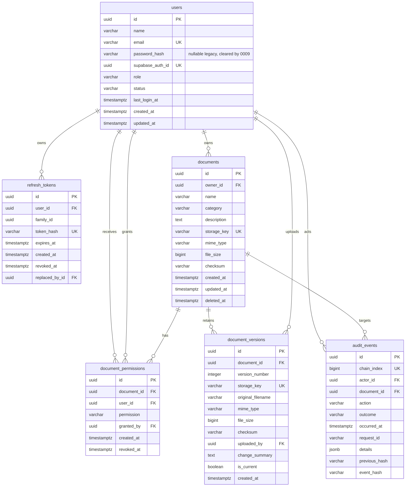

# TrustVault — Database Design

This document describes the PostgreSQL schema used by the authentication, upload, document-management, permission, administrator, audit, preview, and version-history pipelines: tables, columns, constraints, indexes, design trade-offs, connection handling, and the Row-Level Security strategy. It is the reference for `backend/app/models/` and the Alembic migrations through `0009_supabase_auth_identity.py`.

> **Status:** schema implemented and verified against an isolated PostgreSQL instance. Supabase Auth identities are linked separately from database-authoritative roles. Migration `0009` clears legacy local password hashes and revokes old refresh sessions. The repository migration head is `0009`; live Supabase migration state and drift were not re-verified in this local run.

## Entity Relationships



## `users`

| Column | Type | Constraints |
|--------|------|-------------|
| `id` | UUID | Primary key, default `gen_random_uuid()` |
| `name` | VARCHAR(255) | Not null, `length(btrim(name)) > 0` |
| `email` | VARCHAR(320) | Not null, unique (`uq_users_email`), `email = lower(btrim(email))` |
| `password_hash` | VARCHAR(255) | Nullable legacy field; cleared by migration `0009` |
| `supabase_auth_id` | UUID | Nullable, unique provider identity ID |
| `role` | VARCHAR(32) | Not null, `IN ('ADMINISTRATOR', 'USER')` |
| `status` | VARCHAR(16) | Not null, default `'ACTIVE'`, `IN ('ACTIVE', 'DISABLED')` |
| `last_login_at` | TIMESTAMPTZ | Nullable; updated only after successful login |
| `created_at` | TIMESTAMPTZ | Not null, default `now()` |
| `updated_at` | TIMESTAMPTZ | Not null, default `now()`, updated by the ORM |

**Why a constrained string instead of a native enum?** Adding a role to a PostgreSQL enum requires `ALTER TYPE` and careful migration ordering; a `CHECK` constraint is simpler to evolve. The value is still validated by PostgreSQL, and Python `StrEnum` classes keep application code typed.

**Role migration and indexes.** Migration `0004` drops the legacy role constraint, maps `DOCUMENT_OWNER` and `VIEWER` to `USER`, preserves `ADMINISTRATOR`, and installs `ck_users_role` with only the two current roles. It adds `ix_users_role`, `ix_users_status`, and `ix_users_created_at` for administrator filtering/sorting. Downgrade maps every `USER` to `DOCUMENT_OWNER`, restores the legacy constraint, and drops `last_login_at` and the new indexes.

**Credential ownership.** Supabase Auth stores credentials. `password_hash` is nullable for legacy compatibility and is cleared by migration `0009`; `supabase_auth_id` binds the provider identity to the TrustVault user. Roles and status remain local and are never derived from provider metadata.

**Last login.** `last_login_at` is nullable for existing accounts and is updated only after successful credential validation. Failed logins do not advance it.

**Email normalization.** The database requires the stored value to already be lowercase and trimmed. Normalization is performed before insert by Phase 3 auth services; the constraint prevents mixed-case duplicates from bypassing the unique index.

## `refresh_tokens`

| Column | Type | Constraints |
|--------|------|-------------|
| `id` | UUID | Primary key, default `gen_random_uuid()` |
| `user_id` | UUID | Not null, FK `users.id` `ON DELETE CASCADE` |
| `family_id` | UUID | Not null; groups a rotation chain |
| `token_hash` | VARCHAR(71) | Not null, unique, `sha256:<64 hex>` |
| `expires_at` | TIMESTAMPTZ | Not null |
| `created_at` | TIMESTAMPTZ | Not null, default `now()` |
| `revoked_at` | TIMESTAMPTZ | Nullable; set on rotation, logout, or reuse detection |
| `replaced_by_id` | UUID | Nullable, self-FK `ON DELETE SET NULL` |

**Legacy sessions.** Before migration `0009`, raw refresh tokens were returned only in an HttpOnly cookie while PostgreSQL stored `sha256:<hex>`. Migration `0009` revokes all unrevoked rows. The table remains for historical compatibility and test-only coverage; Supabase Auth manages current browser sessions.

**Indexes:** `ix_refresh_tokens_user_id`, `ix_refresh_tokens_family_id`, `ix_refresh_tokens_expires_at`, a partial `ix_refresh_tokens_active_family` on `family_id` `WHERE revoked_at IS NULL`, and a unique constraint on `token_hash`.

## `documents`

| Column | Type | Constraints |
|--------|------|-------------|
| `id` | UUID | Primary key, default `gen_random_uuid()` |
| `owner_id` | UUID | Not null, FK `users.id` `ON DELETE RESTRICT` |
| `name` | VARCHAR(255) | Not null, non-blank |
| `category` | VARCHAR(100) | Nullable |
| `description` | TEXT | Nullable |
| `storage_key` | VARCHAR(512) | Not null, unique, `LIKE 'documents/%'`, not a URL |
| `mime_type` | VARCHAR(255) | Not null |
| `file_size` | BIGINT | Not null, `>= 0` |
| `checksum` | VARCHAR(64) | Not null, SHA-256 hex `^[0-9a-f]{64}$` |
| `next_version_number` | INTEGER | Not null, default `2`, `>= 2`; next number to allocate |
| `created_at` / `updated_at` | TIMESTAMPTZ | Not null, defaults `now()` |
| `deleted_at` | TIMESTAMPTZ | Nullable; soft-delete marker |

**Deletion strategy.** `owner_id` uses `ON DELETE RESTRICT`, so an owner cannot be deleted while documents reference them; ownership must be transferred or documents removed first. Phase 5 uses soft deletion (`deleted_at`) so metadata and history survive and excludes soft-deleted rows from list/detail/update/download/delete. It then attempts best-effort Supabase Storage object cleanup for the current object and every historical version storage key after the database commit. Hard deletion remains out of scope; permission and version rows cascade only if a document is later hard-deleted.

**Storage keys are internal.** The `storage_key` must begin with `documents/` and must not contain `://`, so a backend bug cannot accidentally persist a public URL in the column that identifies a private object. Phase 4 writes generated keys of the form `documents/{owner_uuid}/{random_uuid}.{ext}` and never uses the user filename as the key.

**Phase 4 metadata writes.** The upload service populates `owner_id` from the authenticated session, `name` from validated user metadata, `storage_key` from the generated key, `mime_type` from validated content, `file_size` from the received bytes, and `checksum` from the backend-computed SHA-256. Empty files are rejected, so uploads are positive-size. Upload is object-first then metadata; if the metadata commit fails, object deletion is attempted best-effort. There is no schema change or distributed transaction.

**Phase 6 metadata writes.** Owners and EDIT recipients may change `name`, `category`, and `description`; `updated_at` is maintained by the database. Soft delete sets `deleted_at`. Ownership, storage key, MIME type, size, checksum, and creation time are never client-updatable. Listing/search and shared-document queries use the existing indexes plus the trigram index; no migration is required.

**Indexes:**

| Index | Columns | Purpose |
|-------|---------|---------|
| `ix_documents_owner_id` | `owner_id` | Owner lookups |
| `ix_documents_category` | `category` | Category filtering |
| `ix_documents_created_at` | `created_at` | Recency sorting/pagination |
| `ix_documents_owner_created_at` | `owner_id, created_at` | Owner-scoped listing |
| `ix_documents_category_created_at` | `category, created_at` | Category-scoped listing |
| `ix_documents_owner_active` | `owner_id` WHERE `deleted_at IS NULL` | Active documents per owner |
| `ix_documents_name_trgm` | `name` using `gin_trgm_ops` | Case-insensitive/partial name search (implemented in Phase 5) |

The trigram index requires the `pg_trgm` extension, created by the migration before the index.

**Why `category` is a column and not a table.** Categories have not required independent identity, ownership, or lifecycle, so a nullable string keeps the schema small. Phase 5 continues to treat it as free-form metadata with case-insensitive filtering; promotion to a lookup table remains a future decision.

**Current-file denormalization.** The `storage_key`, `mime_type`, `file_size`, and `checksum` columns on `documents` describe the current content for list/detail/download compatibility. Replacement transactions update them and the current `document_versions` row together. Deleting the current version atomically points these columns at the highest remaining version.

**Persistent version sequence.** Migration `0007` adds `documents.next_version_number` with a check that it is at least `2` and backfills it as `GREATEST(max(version_number) + 1, 2)`. Replacement and content edits take this value before insert and advance it in the same transaction, so deleting the highest version cannot cause a later revision to reuse its number.

## `document_versions`

| Column | Type | Constraints |
|--------|------|-------------|
| `id` | UUID | Primary key, default `gen_random_uuid()` |
| `document_id` | UUID | Not null, FK `documents.id` `ON DELETE CASCADE` |
| `version_number` | INTEGER | Not null, `>= 1`, unique per document |
| `storage_key` | VARCHAR(512) | Not null, unique, `LIKE 'documents/%'`, not a URL |
| `original_filename` | VARCHAR(255) | Not null, non-blank |
| `mime_type` | VARCHAR(255) | Not null |
| `file_size` | BIGINT | Not null, `>= 0` |
| `checksum` | VARCHAR(64) | Not null, SHA-256 hex `^[0-9a-f]{64}$` |
| `uploaded_by` | UUID | Nullable, FK `users.id` `ON DELETE SET NULL` |
| `change_summary` | TEXT | Nullable; bounded by the API to 500 characters |
| `is_current` | BOOLEAN | Not null, default `false`; exactly one current row per document |
| `created_at` | TIMESTAMPTZ | Not null, default `now()` |

**Content history and deliberate deletion.** Each replacement or plain-text edit inserts a new row and flips the previous current row to `is_current = false`. Version rows are never updated except for the current flag during replacement or rollback, and are never deleted implicitly. An owner may explicitly delete a version when more than one remains; deleting the current version flips the highest remaining row back to current and updates the document's denormalized content columns in the same transaction. `UNIQUE (document_id, version_number)` prevents duplicate sequence numbers, `UNIQUE (storage_key)` prevents object aliasing, and the partial unique index `uq_document_versions_current` on `(document_id)` `WHERE is_current` enforces at most one current version even under concurrency. `document_id` cascades on hard deletion; `uploaded_by` uses `SET NULL` so version history survives account deletion.

**Initial backfill.** Migration `0005` inserts version 1/current for every existing document, using the document's original filename (`documents.name`), current current-file columns, owner as uploader, `documents.created_at`, and the summary `Initial upload`. Downgrading removes `document_versions` without changing the denormalized current-file columns.

**Indexes:** `ix_document_versions_document_id`, `ix_document_versions_uploaded_by`, `ix_document_versions_created_at`, the partial unique `uq_document_versions_current`, and the two unique constraints above. Version listings are ordered newest-first by `version_number`.

## `document_permissions`

| Column | Type | Constraints |
|--------|------|-------------|
| `id` | UUID | Primary key, default `gen_random_uuid()` |
| `document_id` | UUID | Not null, FK `documents.id` `ON DELETE CASCADE` |
| `user_id` | UUID | Not null, FK `users.id` `ON DELETE CASCADE` |
| `permission` | VARCHAR(8) | Not null, `IN ('READ', 'EDIT')` |
| `granted_by` | UUID | Nullable, FK `users.id` `ON DELETE SET NULL` |
| `created_at` | TIMESTAMPTZ | Not null, default `now()` |
| `revoked_at` | TIMESTAMPTZ | Nullable, `revoked_at >= created_at` |

**Grant history with one active grant.** A partial unique index `uq_document_permissions_active` on `(document_id, user_id)` `WHERE revoked_at IS NULL` allows only one active grant per user/document pair. Revocation sets `revoked_at` instead of deleting the row, and re-granting inserts a new row. This preserves a complete grant/revoke history for audit and compliance, and the constraint makes duplicate active grants impossible even under concurrency.

**Owner access is implicit.** Document owners are not stored in this table. Ownership is represented by `documents.owner_id`, so the permission table records grants only to other users. This avoids two sources of truth for owner access.

**Deletion semantics.** `document_id` and `user_id` cascade — if a document or user is hard-deleted, its grants are removed. `granted_by` uses `SET NULL` so the grant survives the deletion of the granting user, with attribution intentionally dropped rather than the row being removed.

`EDIT` implies `READ`; that relationship is enforced by the centralized access policy in `app/services/document_access.py`, not by a database constraint. Phase 6 uses this table for owner-managed grants and keeps revocation history.

**Indexes:** `ix_document_permissions_document_id`, `ix_document_permissions_user_id`, the partial unique `uq_document_permissions_active`, a partial `ix_document_permissions_active_user` for "documents shared with me" queries, and `ix_document_permissions_history` on `(document_id, created_at)`.

## `audit_events`

| Column | Type | Constraints |
|--------|------|-------------|
| `id` | UUID | Primary key, default `gen_random_uuid()` |
| `chain_index` | BIGINT | Not null, `>= 1`, unique (`ix_audit_events_chain_index`) |
| `actor_id` | UUID | Nullable, FK `users.id` `ON DELETE SET NULL` |
| `document_id` | UUID | Nullable, FK `documents.id` `ON DELETE SET NULL` |
| `action` | VARCHAR(64) | Not null, extensible (no check) |
| `outcome` | VARCHAR(16) | Not null, `IN ('SUCCESS', 'DENIED', 'FAILURE')` |
| `occurred_at` | TIMESTAMPTZ | Not null, default `now()` |
| `request_id` | VARCHAR(128) | Nullable |
| `details` | JSONB | Not null, default `'{}'`, must be a JSON object |
| `previous_hash` | VARCHAR(64) | Nullable, SHA-256 hex when present |
| `event_hash` | VARCHAR(64) | Not null, SHA-256 hex |

**Deletion should not erase history.** `actor_id` and `document_id` use `ON DELETE SET NULL` rather than a cascade, so deleting a user or document keeps the event with its action, outcome, details, and hashes intact. A test in `tests/test_schema_constraints.py` deletes both a document and its owner and confirms the event remains with null references.

**`action` is intentionally unconstrained.** Later phases add actions without a migration. `outcome` is constrained because it is a small, stable set. `details` must be a JSON object to keep audit queries predictable, and hash columns must be 64-character lowercase hex.

**Chain sequence and hashes.** Migration `0003` adds nullable `chain_index`, backfills existing rows deterministically by `(occurred_at, id)`, then enforces `NOT NULL`, `>= 1`, and uniqueness. The writer takes a PostgreSQL advisory transaction lock and appends the next contiguous index with `previous_hash` and a canonical SHA-256 `event_hash`. A hash chain stored alongside the data it protects detects unauthorized changes but cannot prevent a privileged database administrator from rewriting the chain; the signed checkpoint adds detection relative to the last trusted checkpoint. Events appended after the latest checkpoint and then deleted are not detectable by that checkpoint.

**Details metadata.** Event details include action-specific fields plus the validated request ID, direct socket client IP, and length-limited user-agent when available, and an actor-name snapshot. Authentication and administrative events include `target_user_id`, and document/permission/account events include `resource_type`. The administrator audit API filters on the recorded actor (ID, current name/email, or stored actor-name snapshot), target user, resource, document, action, outcome, and UTC dates; `occurred_today` uses the current UTC calendar day. Passwords, tokens, cookies, authorization headers, session IDs, content, and payloads are rejected by the sanitizer before insert. Details are bounded by depth, item count, and total size.

**Immutability is not database-enforced.** A trigger or revoke-based immutability rule would conflict with the `ON DELETE SET NULL` updates that preserve history. The application exposes no audit UPDATE/DELETE endpoint and writes through a single append path, but the database role is not restricted from direct table changes.

**Indexes:** unique `ix_audit_events_chain_index`; `occurred_at`, `actor_id`, `document_id`, `action`, and `outcome`, plus composite `(document_id, occurred_at)` and `(actor_id, occurred_at)` for document- and actor-scoped history views.

## Row-Level Security

Migration `0008` enables RLS on `users`, `refresh_tokens`, `documents`,
`document_permissions`, `document_versions`, and `audit_events`. It deliberately
adds no client-facing row policies: PostgreSQL's default-deny behavior blocks
row access, and privileges are revoked from `PUBLIC` and, when present, the
Supabase PostgREST `anon` and `authenticated` roles. This prevents a public
Supabase key from bypassing the API to read or mutate application tables.

The backend still enforces ownership, roles, per-document grants, and
administrator-only access on every request. It uses a privileged database
connection, so the application-level authorization checks remain authoritative
for API operations; RLS is an additional barrier against direct public
PostgREST access, not a replacement for those checks or per-user database
policies. Apply the migration to each deployed database and verify its role
grants separately before claiming the deployed instance is protected.

## Migrations

- Alembic configuration: `backend/alembic.ini` (no credentials stored) and `backend/alembic/env.py`.
- Initial migration: `backend/alembic/versions/0001_initial_schema.py` (revision `0001`) creates `pg_trgm`, the four core tables, constraints, and indexes.
- Phase 3 migration: `backend/alembic/versions/0002_add_refresh_tokens.py` (revision `0002`) adds `refresh_tokens` and its indexes.
- Phase 7 migration: `backend/alembic/versions/0003_add_audit_chain_index.py` (revision `0003`) adds `chain_index`, backfills existing audit rows, then adds the positive check and unique index.
- Business-model migration: `backend/alembic/versions/0004_user_roles_and_login_tracking.py` (revision `0004`) adds nullable `last_login_at`, migrates legacy roles, rebuilds `ck_users_role`, and adds role/status/created-at indexes.
- Content-version migration: `backend/alembic/versions/0005_document_versions.py` (revision `0005`) creates `document_versions`, its checks, unique constraints, and indexes, then backfills every existing document as version 1/current.
- `backend/alembic/versions/0008_enable_rls.py` (revision `0008`) enables default-deny RLS on all application tables and revokes direct table/sequence access from `PUBLIC` and Supabase PostgREST client roles when present.
- `backend/alembic/versions/0009_supabase_auth_identity.py` (revision `0009`) adds the unique optional `users.supabase_auth_id`, clears retired local password hashes, and revokes active custom refresh sessions. Existing accounts are imported as Supabase Auth identities by the protected `backend/scripts/import_users_to_supabase_auth.py` script; TrustVault roles remain solely in `users.role`.
- `0001.downgrade()` drops its tables but deliberately leaves the shared `pg_trgm` extension installed; `0002.downgrade()` drops `refresh_tokens`; `0003.downgrade()` drops the chain index, check, and column; `0004.downgrade()` maps users to `DOCUMENT_OWNER`, restores the legacy role constraint, drops the new indexes, and removes `last_login_at`; `0005.downgrade()` drops the version indexes and table while retaining current-file metadata on `documents`.

Common commands (run from `backend/` with `DATABASE_URL` set):

```powershell
alembic current                  # show the applied revision
alembic upgrade head             # apply all migrations
alembic downgrade -1             # revert the latest migration
alembic downgrade base           # revert everything (development only)
alembic revision --autogenerate -m "description"
alembic check                    # detect drift between models and migrations
```

`alembic downgrade base` destroys data and must never be run against production.

## Connection Management

`backend/app/db/` contains:

- `base.py` — the declarative `Base`.
- `url.py` — normalizes `postgres://`/`postgresql://` to `postgresql+psycopg://`, detects the Supabase transaction pooler (port 6543), and detects Supabase hosts requiring SSL.
- `session.py` — lazily builds and caches the engine and session factory; `get_db()` is the FastAPI dependency that always closes its session.

Details:

- **Driver:** psycopg 3 (`psycopg[binary]`), used synchronously through SQLAlchemy 2.x.
- **Pooling:** `pool_size` and `max_overflow` come from `DB_POOL_SIZE` and `DB_MAX_OVERFLOW`; `pool_pre_ping=True` and `pool_recycle=1800` are fixed.
- **SSL:** `sslmode=require` is set automatically for Supabase hosts.
- **Pooler compatibility:** on the transaction pooler (port 6543), psycopg server-side prepared statements are disabled (`prepare_threshold=None`) so pooled connections remain safe.
- **Lazy engine:** importing `app.main` never requires `DATABASE_URL`; the engine is created on first use.

## Testing

Database tests run against an ephemeral PostgreSQL instance started by the `embedded-postgres` package (`backend/tests/conftest.py`). Two disposable databases are created per test session: one migrated for model/constraint/auth/upload/document-management/audit/version tests, one for the migration upgrade/check/downgrade/re-upgrade and `0005` backfill test. The full suite has 258 tests and never reads `DATABASE_URL` or contacts Supabase; storage is faked.

Run the suite:

```powershell
cd backend
.\.venv\Scripts\Activate.ps1
pytest
```

## Applying to Supabase

The repository migration head is `0009`; live Supabase migration state and `alembic check` were not re-verified in this local run. To apply pending migrations, set `DATABASE_URL` to the direct (port 5432) connection string in a trusted shell and run `alembic upgrade head` from `backend/`. The connection string is a secret: provide it through the environment, never in a committed file or command history where it could leak.
