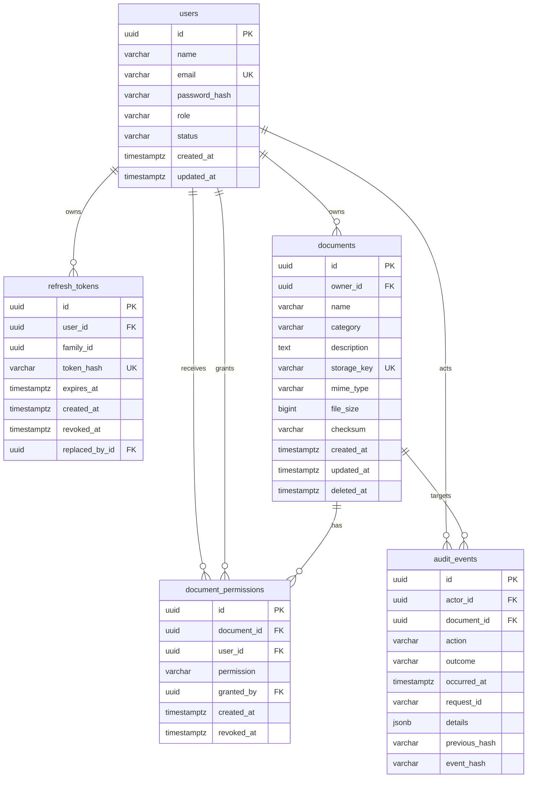

# TrustVault — Database Design

This document describes the PostgreSQL schema implemented across Phases 2 and 3 and used by the Phase 4 upload, Phase 5 document-management, and Phase 6 permission pipelines: tables, columns, constraints, indexes, design trade-offs, connection handling, and the Row-Level Security strategy. It is the reference for `backend/app/models/` and the Alembic migrations `0001_initial_schema.py` and `0002_add_refresh_tokens.py`.

> **Status:** schema implemented and verified against an isolated PostgreSQL instance. Authentication/roles, validated upload metadata writes, document list/update/soft-delete operations, and owner-managed READ/EDIT grants exist; the audit writer does not. Phase 6 adds no migration. Migrations have **not** been applied to the Supabase project.

## Entity Relationships



## `users`

| Column | Type | Constraints |
|--------|------|-------------|
| `id` | UUID | Primary key, default `gen_random_uuid()` |
| `name` | VARCHAR(255) | Not null, `length(btrim(name)) > 0` |
| `email` | VARCHAR(320) | Not null, unique (`uq_users_email`), `email = lower(btrim(email))` |
| `password_hash` | VARCHAR(255) | Not null |
| `role` | VARCHAR(32) | Not null, `IN ('ADMINISTRATOR', 'DOCUMENT_OWNER', 'VIEWER')` |
| `status` | VARCHAR(16) | Not null, default `'ACTIVE'`, `IN ('ACTIVE', 'DISABLED')` |
| `created_at` | TIMESTAMPTZ | Not null, default `now()` |
| `updated_at` | TIMESTAMPTZ | Not null, default `now()`, updated by the ORM |

**Why a constrained string instead of a native enum?** Adding a role to a PostgreSQL enum requires `ALTER TYPE` and careful migration ordering; a `CHECK` constraint is simpler to evolve. The value is still validated by PostgreSQL, and Python `StrEnum` classes keep application code typed.

**Why require `password_hash`?** The column is `NOT NULL`, and Phase 3 always stores a bcrypt hash. An account can never exist without a credential, even after a future bug or manual insert.

**Email normalization.** The database requires the stored value to already be lowercase and trimmed. Normalization is performed before insert by Phase 3 auth services; the constraint prevents mixed-case duplicates from bypassing the unique index.

## `refresh_tokens`

| Column | Type | Constraints |
|--------|------|-------------|
| `id` | UUID | Primary key, default `gen_random_uuid()` |
| `user_id` | UUID | Not null, FK `users.id` `ON DELETE CASCADE` |
| `family_id` | UUID | Not null; groups a rotation chain |
| `token_hash` | VARCHAR(71) | Not null, unique, `sha256:<64 hex>` |
| `expires_at` | TIMESTAMPTZ | Not null |
| `created_at` | TIMESTAMPTZ | Not null, default `now()` |
| `revoked_at` | TIMESTAMPTZ | Nullable; set on rotation, logout, or reuse detection |
| `replaced_by_id` | UUID | Nullable, self-FK `ON DELETE SET NULL` |

**Hashed, rotating sessions.** The raw refresh token is returned only to the browser in an HttpOnly cookie. PostgreSQL stores `sha256:<hex>`; a database leak does not directly yield usable refresh tokens. Every refresh rotates the token, marks the old row revoked, and links it to the replacement. Reuse of an already-rotated token revokes every active token in the same family.

**Indexes:** `ix_refresh_tokens_user_id`, `ix_refresh_tokens_family_id`, `ix_refresh_tokens_expires_at`, a partial `ix_refresh_tokens_active_family` on `family_id` `WHERE revoked_at IS NULL`, and a unique constraint on `token_hash`.

## `documents`

| Column | Type | Constraints |
|--------|------|-------------|
| `id` | UUID | Primary key, default `gen_random_uuid()` |
| `owner_id` | UUID | Not null, FK `users.id` `ON DELETE RESTRICT` |
| `name` | VARCHAR(255) | Not null, non-blank |
| `category` | VARCHAR(100) | Nullable |
| `description` | TEXT | Nullable |
| `storage_key` | VARCHAR(512) | Not null, unique, `LIKE 'documents/%'`, not a URL |
| `mime_type` | VARCHAR(255) | Not null |
| `file_size` | BIGINT | Not null, `>= 0` |
| `checksum` | VARCHAR(64) | Not null, SHA-256 hex `^[0-9a-f]{64}$` |
| `created_at` / `updated_at` | TIMESTAMPTZ | Not null, defaults `now()` |
| `deleted_at` | TIMESTAMPTZ | Nullable; soft-delete marker |

**Deletion strategy.** `owner_id` uses `ON DELETE RESTRICT`, so an owner cannot be deleted while documents reference them; ownership must be transferred or documents removed first. Phase 5 uses soft deletion (`deleted_at`) so metadata and history survive and excludes soft-deleted rows from list/detail/update/download/delete. It then attempts best-effort Wasabi object cleanup after the database commit. Hard deletion remains out of scope; permission rows cascade only if a document is later hard-deleted.

**Storage keys are internal.** The `storage_key` must begin with `documents/` and must not contain `://`, so a backend bug cannot accidentally persist a public URL in the column that identifies a private object. Phase 4 writes generated keys of the form `documents/{owner_uuid}/{random_uuid}.{ext}` and never uses the user filename as the key.

**Phase 4 metadata writes.** The upload service populates `owner_id` from the authenticated session, `name` from validated user metadata, `storage_key` from the generated key, `mime_type` from validated content, `file_size` from the received bytes, and `checksum` from the backend-computed SHA-256. Empty files are rejected, so uploads are positive-size. Upload is object-first then metadata; if the metadata commit fails, object deletion is attempted best-effort. There is no schema change or distributed transaction.

**Phase 6 metadata writes.** Owners and EDIT recipients may change `name`, `category`, and `description`; `updated_at` is maintained by the database. Soft delete sets `deleted_at`. Ownership, storage key, MIME type, size, checksum, and creation time are never client-updatable. Listing/search and shared-document queries use the existing indexes plus the trigram index; no migration is required.

**Indexes:**

| Index | Columns | Purpose |
|-------|---------|---------|
| `ix_documents_owner_id` | `owner_id` | Owner lookups |
| `ix_documents_category` | `category` | Category filtering |
| `ix_documents_created_at` | `created_at` | Recency sorting/pagination |
| `ix_documents_owner_created_at` | `owner_id, created_at` | Owner-scoped listing |
| `ix_documents_category_created_at` | `category, created_at` | Category-scoped listing |
| `ix_documents_owner_active` | `owner_id` WHERE `deleted_at IS NULL` | Active documents per owner |
| `ix_documents_name_trgm` | `name` using `gin_trgm_ops` | Case-insensitive/partial name search (implemented in Phase 5) |

The trigram index requires the `pg_trgm` extension, created by the migration before the index.

**Why `category` is a column and not a table.** Categories have not required independent identity, ownership, or lifecycle, so a nullable string keeps the schema small. Phase 5 continues to treat it as free-form metadata with case-insensitive filtering; promotion to a lookup table remains a future decision.

## `document_permissions`

| Column | Type | Constraints |
|--------|------|-------------|
| `id` | UUID | Primary key, default `gen_random_uuid()` |
| `document_id` | UUID | Not null, FK `documents.id` `ON DELETE CASCADE` |
| `user_id` | UUID | Not null, FK `users.id` `ON DELETE CASCADE` |
| `permission` | VARCHAR(8) | Not null, `IN ('READ', 'EDIT')` |
| `granted_by` | UUID | Nullable, FK `users.id` `ON DELETE SET NULL` |
| `created_at` | TIMESTAMPTZ | Not null, default `now()` |
| `revoked_at` | TIMESTAMPTZ | Nullable, `revoked_at >= created_at` |

**Grant history with one active grant.** A partial unique index `uq_document_permissions_active` on `(document_id, user_id)` `WHERE revoked_at IS NULL` allows only one active grant per user/document pair. Revocation sets `revoked_at` instead of deleting the row, and re-granting inserts a new row. This preserves a complete grant/revoke history for audit and compliance, and the constraint makes duplicate active grants impossible even under concurrency.

**Owner access is implicit.** Document owners are not stored in this table. Ownership is represented by `documents.owner_id`, so the permission table records grants only to other users. This avoids two sources of truth for owner access.

**Deletion semantics.** `document_id` and `user_id` cascade — if a document or user is hard-deleted, its grants are removed. `granted_by` uses `SET NULL` so the grant survives the deletion of the granting user, with attribution intentionally dropped rather than the row being removed.

`EDIT` implies `READ`; that relationship is enforced by the centralized access policy in `app/services/document_access.py`, not by a database constraint. Phase 6 uses this table for owner-managed grants and keeps revocation history.

**Indexes:** `ix_document_permissions_document_id`, `ix_document_permissions_user_id`, the partial unique `uq_document_permissions_active`, a partial `ix_document_permissions_active_user` for "documents shared with me" queries, and `ix_document_permissions_history` on `(document_id, created_at)`.

## `audit_events`

| Column | Type | Constraints |
|--------|------|-------------|
| `id` | UUID | Primary key, default `gen_random_uuid()` |
| `actor_id` | UUID | Nullable, FK `users.id` `ON DELETE SET NULL` |
| `document_id` | UUID | Nullable, FK `documents.id` `ON DELETE SET NULL` |
| `action` | VARCHAR(64) | Not null, extensible (no check) |
| `outcome` | VARCHAR(16) | Not null, `IN ('SUCCESS', 'DENIED', 'FAILURE')` |
| `occurred_at` | TIMESTAMPTZ | Not null, default `now()` |
| `request_id` | VARCHAR(128) | Nullable |
| `details` | JSONB | Not null, default `'{}'`, must be a JSON object |
| `previous_hash` | VARCHAR(64) | Nullable, SHA-256 hex when present |
| `event_hash` | VARCHAR(64) | Not null, SHA-256 hex |

**Deletion should not erase history.** `actor_id` and `document_id` use `ON DELETE SET NULL` rather than a cascade, so deleting a user or document keeps the event with its action, outcome, details, and hashes intact. A test in `tests/test_schema_constraints.py` deletes both a document and its owner and confirms the event remains with null references.

**`action` is intentionally unconstrained.** Later phases add actions without a migration. `outcome` is constrained because it is a small, stable set. `details` must be a JSON object to keep audit queries predictable, and hash columns must be 64-character lowercase hex.

**Hash chain.** `previous_hash` and `event_hash` hold the Phase 7 hash chain. No code writes them yet; the columns exist so the write path does not require a schema migration later.

**Immutability is not database-enforced in Phase 2.** A trigger or revoke-based immutability rule would block the `ON DELETE SET NULL` updates that preserve history. Phase 7 will implement the append-only write path and revisit enforcement alongside hash-chain verification and external checkpoints.

**Indexes:** `occurred_at`, `actor_id`, `document_id`, `action`, `outcome`, plus composite `(document_id, occurred_at)` and `(actor_id, occurred_at)` for document- and actor-scoped history views.

## RLS Strategy (Not Enabled)

Row-Level Security is planned as defense-in-depth, not as the primary authorization mechanism. **No RLS policies are enabled.** Phase 3 keeps the backend on a single privileged database role; authentication establishes an application identity, not a per-request PostgreSQL identity. Because that role bypasses RLS, application-level authorization remains authoritative and policies are deferred until they can be tested meaningfully.

1. The backend owns authorization and will enforce ownership, role, and per-document grants in application code (Phases 3 and 6).
2. Phase 3 keeps a single privileged role; per-request database identities and tested RLS policies remain deferred.
3. The frontend never connects to the database, and the service/privileged credential is never exposed to clients.
4. In later phases, policies will be additive safety nets (for example, `documents` visible only to owner, administrator, or grant holder) and will be tested before being claimed as active.

Until then, TrustVault must not be described as having database-enforced access control.

## Migrations

- Alembic configuration: `backend/alembic.ini` (no credentials stored) and `backend/alembic/env.py`.
- Initial migration: `backend/alembic/versions/0001_initial_schema.py` (revision `0001`) creates `pg_trgm`, the four core tables, constraints, and indexes.
- Phase 3 migration: `backend/alembic/versions/0002_add_refresh_tokens.py` (revision `0002`) adds `refresh_tokens` and its indexes.
- `0001.downgrade()` drops its tables but deliberately leaves the shared `pg_trgm` extension installed; `0002.downgrade()` drops `refresh_tokens`.

Common commands (run from `backend/` with `DATABASE_URL` set):

```powershell
alembic current                  # show the applied revision
alembic upgrade head             # apply all migrations
alembic downgrade -1             # revert the latest migration
alembic downgrade base           # revert everything (development only)
alembic revision --autogenerate -m "description"
alembic check                    # detect drift between models and migrations
```

`alembic downgrade base` destroys data and must never be run against production.

## Connection Management

`backend/app/db/` contains:

- `base.py` — the declarative `Base`.
- `url.py` — normalizes `postgres://`/`postgresql://` to `postgresql+psycopg://`, detects the Supabase transaction pooler (port 6543), and detects Supabase hosts requiring SSL.
- `session.py` — lazily builds and caches the engine and session factory; `get_db()` is the FastAPI dependency that always closes its session.

Details:

- **Driver:** psycopg 3 (`psycopg[binary]`), used synchronously through SQLAlchemy 2.x.
- **Pooling:** `pool_size` and `max_overflow` come from `DB_POOL_SIZE` and `DB_MAX_OVERFLOW`; `pool_pre_ping=True` and `pool_recycle=1800` are fixed.
- **SSL:** `sslmode=require` is set automatically for Supabase hosts.
- **Pooler compatibility:** on the transaction pooler (port 6543), psycopg server-side prepared statements are disabled (`prepare_threshold=None`) so pooled connections remain safe.
- **Lazy engine:** importing `app.main` never requires `DATABASE_URL`; the engine is created on first use.

## Testing

Database tests run against an ephemeral PostgreSQL instance started by the `embedded-postgres` package (`backend/tests/conftest.py`). Two disposable databases are created per test session: one migrated for model/constraint/auth/upload/document-management tests, one for the migration upgrade/check/downgrade/re-upgrade test. The full suite has 146 tests and never reads `DATABASE_URL`, contacts Supabase, or contacts Wasabi; storage is faked.

Run the suite:

```powershell
cd backend
.\.venv\Scripts\Activate.ps1
pytest
```

## Applying to Supabase

The migrations have **not** been applied to the Supabase project. To apply them, set `DATABASE_URL` to the direct (port 5432) connection string in a trusted shell and run `alembic upgrade head` from `backend/`. The connection string is a secret: provide it through the environment, never in a committed file or command history where it could leak.
